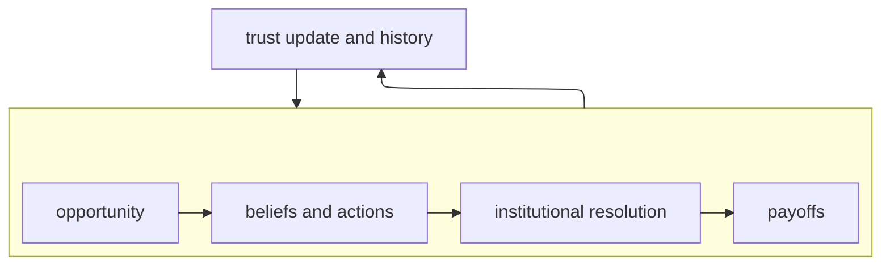
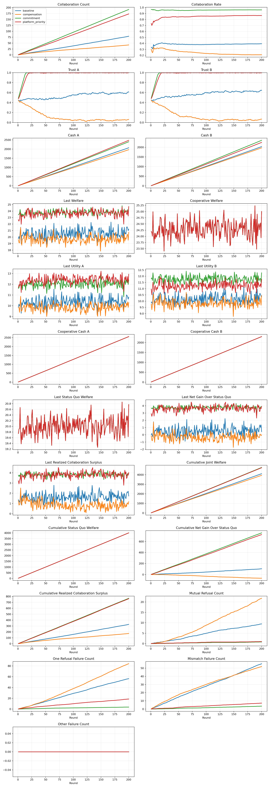

# Designing Institutions for Decentralized Logistics Collaboration


This repository contains the simulation code for:

> Konstantinos Rigos and Martijn R. K. Mes, **"Designing Institutions for Decentralized Logistics Collaboration: An Agent-Based Simulation Approach,"** submitted to the 2026 Winter Simulation Conference.

The model studies how rules for coordinating logistics exchanges influence collaboration between autonomous carriers. Two carriers repeatedly encounter opportunities to exchange transportation jobs. They choose whether to take the other carrier's job, give away their own job, or refuse. The active institutional regime converts those joint actions into an outcome. The resulting success or failure changes payoffs and trust, which then affects later decisions.




The implementation combines:

- [Mesa](https://mesa.readthedocs.io/) for the repeated agent-based simulation;
- SWI-Prolog rules for the institutional action situation;
- a vendored copy of the [`norms-games`](https://github.com/nmontesg/norms-games) `ngames` package for constructing games from those rules; and
- Solara for an optional interactive dashboard.

## Institutional regimes

All regimes use the same agents and opportunity-generation process. They differ in how actions are resolved and how gains or coordination failures are treated.

| Regime | Main mechanism |
| --- | --- |
| `baseline` | Direct exchange without extra coordination support. |
| `compensation` | Transfers part of the executor's gain to the carrier giving away its job. |
| `commitment` | Reduces coordination risk by resolving some otherwise incompatible choices as successful exchanges. |
| `platform_priority` | Lets the platform resolve a conflict between two potential takers by selecting the feasible execution with the highest joint welfare. |

The Prolog files in `institutions/<regime>/` describe participants, positions, available choices, joint-action resolution, and regime parameters. The Python layer samples round-specific opportunities, evaluates actions, computes payoffs, updates trust, and records results.

## Requirements

- Python 3.10 or newer
- [SWI-Prolog](https://www.swi-prolog.org/Download.html), including its command-line tools
- A 64-bit Python installation with a matching 64-bit SWI-Prolog installation

Confirm that SWI-Prolog is installed and available on `PATH`:

```powershell
swipl --version
```

If that command is not found, install SWI-Prolog and open a new terminal. On Windows, the default executable directory is usually `C:\Program Files\swipl\bin`.

## Installation

Clone or download this repository, then run the following commands from its root directory (the directory containing `run.py`).

### Windows PowerShell

```powershell
py -3 -m venv .venv
.\.venv\Scripts\Activate.ps1
python -m pip install --upgrade pip
python -m pip install -r requirements.txt
```

If PowerShell blocks activation, the environment can be used without activating it:

```powershell
.\.venv\Scripts\python.exe -m pip install -r requirements.txt
.\.venv\Scripts\python.exe run.py --help
```

### macOS or Linux

```bash
python3 -m venv .venv
source .venv/bin/activate
python -m pip install --upgrade pip
python -m pip install -r requirements.txt
```

No separate installation of `norms-games` is needed: the required `ngames` source is included in this repository.

## Quick start

Run a short baseline simulation to check the installation:

```powershell
python run.py --mode single --institution baseline --rounds 10 --seed 42
```

The command prints summary metrics and writes these files to `outputs/`:

- `single_baseline_summary.csv`: one row of final run-level metrics;
- `single_baseline_trace.csv`: metrics recorded after every round.

Use `python run.py --help` to see every command-line option.

## Run experiments

### One regime

```powershell
python run.py --mode single --institution commitment --rounds 200 --seed 42
```

Valid institution names are `baseline`, `compensation`, `commitment`, and `platform_priority`.

### Compare all regimes

The following runs five replications per regime and creates CSV files plus a compact trajectory plot:

```powershell
python run.py --mode batch --rounds 200 --replications 5 --seed 42 --plot
```

`--mode both` runs the requested single regime first and then the all-regime batch. Use `--output-dir <directory>` to write results somewhere other than `outputs/`.

### Main paper configuration

The numerical experiment in the paper uses 200 rounds and 30 seeds for each regime. Run that configuration with:


```powershell
python multi_seed_plot.py --institution all --rounds 200 --num-seeds 30 --base-seed 42
```

This creates, for each regime:

- a trace containing every seed and round;
- a mean trace aggregated by round; and
- a figure containing the recorded metrics.

It also creates combined all-regime traces and a figure comparing the regime means. Explicit seeds can be supplied with, for example, `--seeds 10,20,30`. To limit the plots to selected columns, use `--metrics collaboration_rate trust_a trust_b last_welfare`.

The model is stochastic. Keep the seed arguments fixed for reproducible runs. Runtime grows approximately linearly with the number of rounds and seeds.

## Interactive dashboard

Start the Solara interface from the repository root:

```powershell
python -m solara run app.py
```

Open the local address printed in the terminal. The dashboard lets you change the institution, number of rounds, initial trust, the two carriers' risk levels, the weight placed on risk, and the random seed. It displays actions and outcomes alongside collaboration, welfare, utility, trust, and accumulated payoff trajectories.

After changing a parameter, reset the model in the dashboard so that Solara constructs a new simulation with the selected values.

## What happens in one round

1. `OpportunityGenerator` samples status-quo payoffs, potential collaboration surplus, its distribution between the carriers, and whether each carrier can feasibly take the other's job.
2. Each `CarrierAgent` turns its trust value into a belief over the other carrier's actions.
3. The carrier scores its feasible actions using expected payoff, risk sensitivity, and the possible collaboration upside, then makes a bounded-rational stochastic choice.
4. `NormsGamesAdapter` applies the selected regime's Prolog rules to the joint action and obtains an institutional outcome.
5. Python computes the two payoffs, any compensation transfer, and any failure penalty.
6. The model updates trust, accumulated payoffs, collaboration and failure counts, and the per-round data trace.

Trust is the feedback mechanism across rounds. Successful collaboration raises trust. Refusal and mismatched choices can lower it. Institutional rules therefore affect later behaviour indirectly as well as changing the current outcome.

## Outputs and metrics

The most useful output columns are:

| Metric | Meaning |
| --- | --- |
| `collaboration_rate` | Successful exchanges divided by elapsed rounds. |
| `trust_a`, `trust_b` | Each carrier's current trust in the other carrier, bounded to `[0, 1]`. |
| `cash_a`, `cash_b` | Accumulated realized payoff for each carrier. |
| `last_welfare` | Sum of both carriers' realized payoffs in the current round. |
| `cooperative_welfare` | Counterfactual welfare from the best feasible cooperative execution. |
| `cumulative_net_gain_over_status_quo` | Cumulative realized welfare minus independent-execution welfare. |
| `mutual_refusal_count` | Rounds in which both carriers refused. |
| `one_refusal_failure_count` | Failed attempts involving one refusal. |
| `mismatch_failure_count` | Failed non-refusal choices that did not form a compatible exchange. |

Existing files in `outputs/` are example results. Running a command with the same output prefix overwrites the corresponding files, so choose a separate `--output-dir` when preserving them matters.

## Repository structure

```text
.
|-- run.py                 # single-run and batch command-line interface
|-- multi_seed_plot.py     # experiments over many seeds and regime plots
|-- app.py                 # interactive Solara dashboard
|-- model.py               # repeated-round Mesa model and data collection
|-- agents.py              # carrier decision rule and agent state
|-- opportunities.py       # stochastic collaboration opportunities
|-- institutions.py        # regime configuration and Prolog parameter loading
|-- adapter.py             # Prolog/ngames outcome resolution and Python payoffs
|-- institutions/          # one inspectable Prolog rule set per regime
|-- ngames/                # vendored norms-games code and its MIT license
|-- outputs/               # generated CSV files and figures
|-- requirements.txt       # Python dependencies
```

## Third-party code and attribution

The `ngames/` directory is derived from Nieves Montes Gómez's [`norms-games`](https://github.com/nmontesg/norms-games) project, which provides a computational implementation of the Institutional Analysis and Development framework and generates games from Action Situation Language descriptions. It is distributed under the MIT License; the upstream copyright and license notice is preserved in [ngames/LICENSE](ngames/LICENSE).

## Modifying an institution

Each regime has `agents.pl`, `states.pl`, and `rules.pl` files under `institutions/<regime>/`. The `rules.pl` file is the main place to inspect or change:

- IAD boundary, position, choice, and aggregation rules;
- compensation and coordination-failure parameters; and
- the distributions used to generate opportunities.

Numeric `institution_param(...)` declarations are loaded by `institutions.py`, so the Prolog rule file remains the central configuration for regime-specific experiments. A new regime also needs an entry in `REGIMES` and an `InstitutionSpec` in `institutions.py`.

